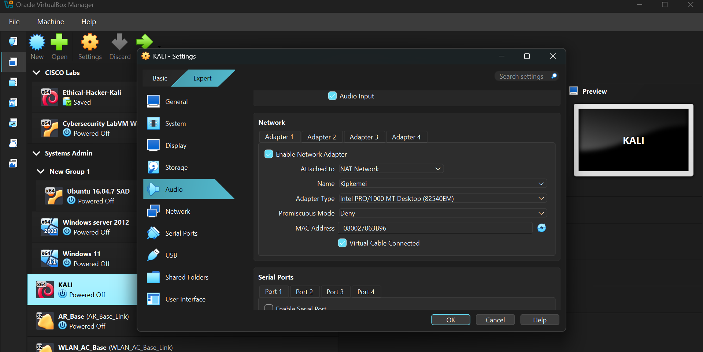
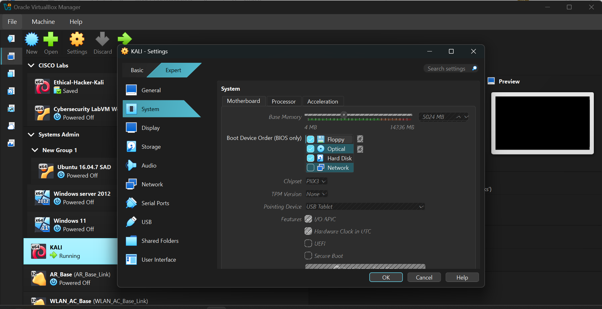
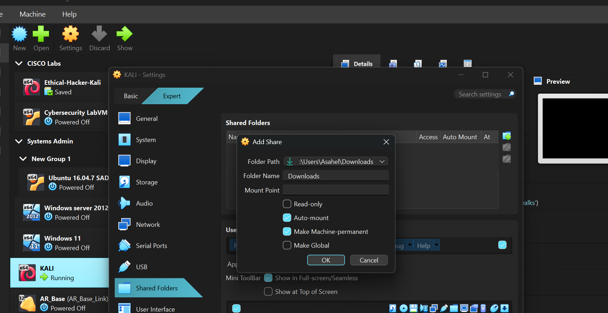

# Networkwalks_Internship

# Cybersecurity Lab Environment Setup

**Week 1 Project – VirtualBox and Kali Linux Lab Setup**

## Project Overview

This project involves setting up a virtual cybersecurity and penetration-testing laboratory using VirtualBox and Kali Linux.

The objective is to establish a controlled environment for conducting security assessments, network scanning, reconnaissance, vulnerability analysis, and other authorized penetration-testing activities.

The laboratory operates on a private virtual network, allowing additional virtual machines to be introduced as targets for security testing.

---

## Lab Requirements

| Requirement | Status |
|---|---|
| VirtualBox as the virtualization platform | Completed |
| Kali Linux as the attacking machine | Completed |
| Network subnet: `10.0.0.0/24` | Completed |
| NAT Network configured | Completed |
| Shared Clipboard and Drag'n'Drop enabled | Completed |
| Shared folder (`/downloads`) | Completed |
| Kali IP: `10.0.0.50/24` | Completed |
| Internet connectivity | Completed |

---

## Tools and Technologies

- **Oracle VirtualBox** – Virtualization platform.
- **Kali Linux** – Penetration-testing operating system.
- **7-Zip** – Archive and file management.
- **nmcli** – NetworkManager command-line utility for network configuration.

---

## 1. Network Configuration

### Creating the NAT Network

I accessed **File > Tools > Network** in VirtualBox and navigated to the **NAT Networks** tab. I created a network named `NatNetwork`, configured its IPv4 prefix as `10.0.0.0/24`, and enabled DHCP for automatic IP address assignment.



### Configuring Kali VM Network Settings

I selected the Kali Linux virtual machine and navigated to **Settings > Network**. Adapter 1 was configured to use the **NAT Network** attachment type, with `NatNetwork` selected.

Under **Advanced**, I configured Promiscuous Mode to **Allow All**, enabling the virtual machine to capture network traffic permitted by the virtual network configuration.



*Note: Kali Linux and VirtualBox were already installed before this project. Therefore, the work focused on configuration rather than installation.*

---

## 2. Virtual Machine Hardware Configuration

### System and Display Settings

I adjusted the virtual machine's hardware configuration to support its operation.

Under **System > Motherboard**, I configured the allocated memory to 504 MB. Under **System > Processor**, I assigned multiple CPU cores.

I also verified that **Enable Nested Paging** was enabled under Acceleration and increased the allocated video memory under Display to improve graphical performance.



### Configuring Shared Folders and Clipboard

To facilitate file exchange between the host operating system and the virtual machine, I navigated to **Settings > Shared Folders** and added the host's Downloads directory:

`C:\Users\user11\Downloads\`

I enabled **Auto-mount** and **Make Permanent**.

Additionally, under **General > Advanced**, I configured both Shared Clipboard and Drag'n'Drop to **Bidirectional**, allowing data transfer between the host and guest operating systems.


---

## 3. IP Configuration and Connectivity Troubleshooting

### Initial Issue: Unreachable Gateway

Initially, I assigned the Kali virtual machine a static IP address of `10.0.0.2/24`. However, attempts to reach the default gateway (`10.0.0.1`) and access the internet were unsuccessful.

The issue was related to the address allocation within the VirtualBox NAT Network. The selected address was unsuitable for the configured network services.

### Resolution: Assigning a Different IP Address

I reassigned the Kali virtual machine to `10.0.0.50/24`, an address within the configured subnet.

The following commands were used to update the network configuration:

```bash
sudo nmcli connection modify "Wired connection 1" ipv4.addresses 10.0.0.50/24

sudo nmcli connection down "Wired connection 1"

sudo nmcli connection up "Wired connection 1"
```

This updated the static IP configuration and restarted the network connection to apply the changes.

---

## Project Outcome

The laboratory environment was successfully configured with Kali Linux operating on a dedicated VirtualBox NAT Network.

The setup provides a foundation for subsequent cybersecurity practical exercises, including network reconnaissance, vulnerability scanning, penetration testing, and security analysis.

The environment can also be extended by introducing additional virtual machines to simulate target systems within the isolated laboratory network.
